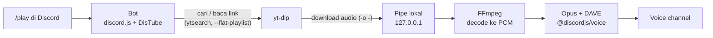

# music-dc

Bot musik Discord yang di-host sendiri. Jalan di satu proses Node pakai discord.js, DisTube, yt-dlp, dan FFmpeg, tanpa Lavalink, Java, atau Docker.

[Halaman project](https://adrawsf.github.io/music-dc/) · [Mulai cepat](#mulai-cepat) · [Cara kerja](#cara-kerjanya) · [Troubleshooting](#troubleshooting)

---

## Kenapa project ini ada

Versi pertama bot ini pakai **Lavalink**: server audio Java terpisah dengan plugin YouTube. Lama-lama YouTube makin ketat dan plugin-nya gagal terus dengan error *"All clients failed to load the item"*. Selain itu, buat sekadar muter lagu di server tongkrongan, harus jalanin Java + Docker juga.

**music-dc** menyederhanakan semuanya. Bot langsung pakai **yt-dlp**, tool paling cepat dapat fix tiap kali YouTube berubah, dan **FFmpeg**, dijalankan dari satu proses Node. Kalau YouTube error lagi, cukup `npm run update-ytdlp`.

## Fitur

| | |
|---|---|
| **Putar dari mana aja** | Judul lagu, link video, link playlist YouTube, plus SoundCloud, Bandcamp, dan [ratusan situs lain](https://github.com/yt-dlp/yt-dlp/blob/master/supportedsites.md) yang didukung yt-dlp |
| **Playlist besar tetap cepat** | Daftar lagu dibaca pakai `--flat-playlist`. Playlist 182 lagu kebaca dalam ±4 detik |
| **Anti HTTP 403** | yt-dlp sendiri yang download audionya, lalu di-pipe ke FFmpeg lewat `127.0.0.1`. FFmpeg nggak pernah ditolak server YouTube |
| **Voice E2EE (DAVE)** | `@discordjs/voice` 0.19 sudah support DAVE, enkripsi voice yang wajib di Discord sejak Maret 2026 |
| **Cookies opsional** | Buat video yang minta login atau "confirm you're not a bot" |
| **yt-dlp auto-update** | Didownload otomatis ke `bin/` dan di-update tiap bot start |
| **Auto-leave** | Keluar 2 menit setelah queue habis, atau 1 menit setelah voice channel kosong |
| **Multi-server** | Queue, volume, loop, dan timer terpisah per server |
| **Gaya bahasa santai** | Semua balasan bot pakai bahasa Indonesia santai, lengkap dengan embed |

## Commands

| Command | Fungsi |
|---|---|
| `/play <query>` | Putar dari judul, link video, atau link playlist |
| `/skip` | Skip lagu yang lagi diputar |
| `/stop` | Stop, hapus queue, dan keluar dari voice |
| `/pause` | Pause atau lanjutkan (toggle) |
| `/queue [page]` | Lihat antrian, 10 lagu per halaman |
| `/nowplaying` | Lagu sekarang + progress bar |
| `/loop <mode>` | `Off` / `Lagu ini` / `Seluruh queue` |
| `/shuffle` | Acak antrian (lagu yang lagi diputar nggak ikut diacak) |
| `/volume <1-150>` | Atur volume |
| `/remove <posisi>` | Hapus lagu dari antrian |

Semua command musik ngecek dulu apakah lo ada di **voice channel yang sama** dengan bot. `/play` juga ngecek izin **View Channel / Connect / Speak** bot sebelum join.

## Cara kerjanya



1. **Resolve**: [`src/ytdlp.js`](src/ytdlp.js) adalah plugin DisTube buatan sendiri. Judul dicari pakai `ytsearch1:`, link playlist dibaca pakai `--flat-playlist`, dan video yang private atau dihapus otomatis dilewati.
2. **Stream**: waktu lagu mau diputar, yt-dlp mulai download audionya (`-f ba -o -`). Plugin nunggu byte pertama, jadi error kayak "video unavailable" atau "minta login" langsung kelihatan dengan pesan aslinya.
3. **Pipe**: byte audio dilewatin server HTTP kecil di `127.0.0.1` (port acak, token sekali pakai). FFmpeg membaca dari situ, bukan dari URL `googlevideo.com`, jadi nggak kena HTTP 403.
4. **Voice**: FFmpeg decode ke PCM, `@discordjs/opus` encode ke Opus, lalu `@discordjs/voice` kirim lewat voice terenkripsi DAVE.

> **Kenapa nggak pakai `@distube/yt-dlp` atau `@distube/youtube`?** `@distube/yt-dlp` (terakhir rilis 2024) nggak bisa search judul, nggak bisa pakai cookies, dan bongkar playlist satu per satu. `@distube/youtube` streaming lewat ytdl-core, yang kena blokir YouTube yang sama kayak Lavalink tadi.

## Mulai cepat

> Panduan ini buat **Windows**. Butuh PowerShell atau Windows Terminal.

### 1. Install Node.js dan FFmpeg
```powershell
winget install OpenJS.NodeJS.LTS   # Node 22.12+ (disarankan 24 LTS)
winget install Gyan.FFmpeg
```
**Tutup lalu buka lagi terminal-nya** (biar PATH ke-refresh), lalu cek: `node -v` dan `ffmpeg -version`.
Kalau `ffmpeg` tetap "not recognized", isi `FFMPEG_PATH` di `.env` dengan path lengkap `ffmpeg.exe`.

**yt-dlp nggak perlu di-install manual.** Pas `npm start` pertama kali, bot download `yt-dlp.exe` ke `bin/` dan update sendiri tiap start. Kalau lebih suka lewat winget: `winget install yt-dlp.yt-dlp`, lalu isi `YTDLP_PATH=yt-dlp` di `.env`.

> YouTube sekarang butuh JavaScript runtime buat yt-dlp. Bot otomatis pakai Node yang lagi jalan (`--js-runtimes node`), jadi nggak perlu install Deno.

### 2. Bikin bot di Discord
1. Buka https://discord.com/developers/applications, klik **New Application**.
2. Copy **Application ID** dari tab *General Information*. Ini `CLIENT_ID`.
3. Di tab **Bot**, klik **Reset Token** lalu copy. Ini `DISCORD_TOKEN` (jangan disebar!).
4. Di tab **OAuth2 → URL Generator**:
   - Scopes: `bot`, `applications.commands`
   - Bot permissions: `View Channels`, `Send Messages`, `Embed Links`, `Connect`, `Speak`
   - Buka URL yang muncul untuk invite bot ke server lo.

### 3. Konfigurasi dan jalankan
```powershell
git clone https://github.com/adrawsf/music-dc.git
cd music-dc
copy .env.example .env      # isi DISCORD_TOKEN, CLIENT_ID, dan (opsional) GUILD_ID
npm install
npm run deploy              # daftarkan slash command (ulangi tiap nambah/ubah command)
npm start                   # atau: npm run dev (auto-restart saat file berubah)
```
Kalau berhasil, di console muncul:
```
🎞️  FFmpeg OK
📼 yt-dlp 2026.xx.xx
✅ Logged in as NamaBot#1234 (1 server)
```
Masuk voice channel, lalu ketik `/play` dan judul lagu favorit lo.

Cara dapat `GUILD_ID`: di Discord nyalakan *Settings → Advanced → Developer Mode*, lalu klik kanan server dan pilih **Copy Server ID**. Kalau `GUILD_ID` diisi, command langsung muncul di server itu. Kalau dikosongkan, command didaftarkan **global** ke semua server (bisa butuh beberapa menit).

## Konfigurasi (`.env`)

| Variabel | Default | Keterangan |
|---|---|---|
| `DISCORD_TOKEN` | — | Token bot (wajib) |
| `CLIENT_ID` | — | Application ID (wajib buat `npm run deploy`) |
| `GUILD_ID` | kosong | Isi = command cuma di server itu; kosong = global |
| `DEFAULT_VOLUME` | `60` | Volume awal tiap queue baru (1–150) |
| `YTDLP_PATH` | kosong | Path/command yt-dlp. Kosong = pakai `bin/` yang didownload otomatis |
| `YTDLP_AUTO_UPDATE` | `true` | Update yt-dlp bawaan tiap start |
| `YTDLP_STREAM_MODE` | `pipe` | `pipe` (anti 403) atau `direct` (FFmpeg buka URL YouTube langsung) |
| `YT_COOKIES_PATH` | kosong | Path `cookies.txt` (format Netscape) |
| `FFMPEG_PATH` | `ffmpeg` | Path `ffmpeg.exe` kalau nggak ada di PATH |
| `DEBUG` | `false` | Log debug DisTube di console |

## Cookies YouTube (opsional)

Kadang YouTube minta login ("Sign in to confirm you're not a bot", video 18+, video members). Bot bisa pakai cookies dari akun Google.

> **Penting: pakai akun Google cadangan, jangan akun utama.** Ada kemungkinan akun yang cookies-nya dipakai bot kena limit atau ban dari YouTube.

1. Buka jendela **Incognito/Private** baru di browser.
2. Login ke YouTube pakai akun cadangan.
3. Di tab yang sama, buka `https://www.youtube.com/robots.txt` (cuma tab itu yang kebuka).
4. Export cookies `youtube.com` ke format **Netscape** pakai ekstensi **"Get cookies.txt LOCALLY"** (open-source; izinkan jalan di Incognito). Simpan sebagai `cookies.txt` di folder bot.
5. **Tutup jendela Incognito-nya tanpa logout.** Kalau logout, cookies-nya langsung nggak berlaku.
6. Isi `YT_COOKIES_PATH=./cookies.txt` di `.env`, lalu restart bot. Di console muncul `📼 yt-dlp ... (pakai cookies)`.

`cookies.txt` sudah masuk `.gitignore`. **Jangan pernah di-commit atau dikirim ke orang**, karena isinya sesi login akun lo.

## Kalau YouTube error lagi

YouTube sering ganti sistemnya, dan yt-dlp biasanya rilis fix dalam beberapa hari.

1. **Update yt-dlp**: `npm run update-ytdlp` (atau `winget upgrade yt-dlp.yt-dlp`), lalu restart bot.
2. **Tes yt-dlp langsung**, biar tahu masalahnya di yt-dlp atau di bot:
   ```powershell
   .\bin\yt-dlp.exe -f ba -g --js-runtimes node "https://www.youtube.com/watch?v=dQw4w9WgXcQ"
   ```
   Kalau keluar URL `googlevideo.com`, yt-dlp-nya sehat.
3. Kalau errornya soal login/bot, pasang cookies.
4. Cek [issue tracker yt-dlp](https://github.com/yt-dlp/yt-dlp/issues) buat masalah YouTube terbaru.

## Troubleshooting

| Masalah | Solusi |
|---|---|
| Slash command nggak muncul | Jalankan `npm run deploy`. Command global bisa butuh beberapa menit. |
| Command muncul **dobel** | Command terdaftar di server *dan* global. Hapus yang per-server (deploy ulang dengan `GUILD_ID` itu dan daftar kosong). |
| `❌ FFmpeg nggak ketemu` | `winget install Gyan.FFmpeg`, **buka terminal baru**. Atau isi `FFMPEG_PATH`. |
| `❌ yt-dlp belum siap` / gagal download | GitHub nge-limit IP lo. `winget install yt-dlp.yt-dlp`, lalu isi `YTDLP_PATH=yt-dlp`. |
| `ffmpeg exited with code 3436169992` | Ini HTTP 403 dari YouTube. Pastikan `YTDLP_STREAM_MODE=pipe` (default). |
| "Sign in to confirm you're not a bot" | Pasang cookies. Kalau sudah, export ulang (mungkin kedaluwarsa). |
| `Gue nggak punya izin View Channel…` | Kasih izin **View Channel, Connect, Speak** ke role bot di channel atau kategorinya. |
| `DiscordAPIError[10062] Unknown interaction` | Biasanya ada **2 proses bot jalan barengan**. Matiin salah satu. |
| Lagu gagal diputar, bot skip terus | `npm run update-ytdlp`, restart. Nyalakan `DEBUG=true` buat log lengkap. |
| Bot join tapi nggak ada suara | Cek `npm ls @discordjs/voice` (harus ≥ 0.19 buat DAVE), izin **Speak**, dan `/volume 100`. |
| `npm install` error di `@discordjs/opus` | Pakai Node LTS, atau ganti encoder: `npm uninstall @discordjs/opus && npm install opusscript`. |
| `/play` butuh ±5–9 detik sebelum bunyi | Normal: yt-dlp nyari lagu dulu, lalu mulai download audionya. |

## Struktur

```
├── docs/                     # halaman GitHub Pages (index.html)
├── bin/                      # yt-dlp.exe (auto-download, nggak di-commit)
├── src/
│   ├── index.js              # client, DisTube, event player, auto-leave
│   ├── ytdlp.js              # plugin DisTube berbasis yt-dlp (search, playlist, pipe stream, cookies)
│   ├── deploy-commands.js    # registrasi slash command
│   ├── update-ytdlp.js       # npm run update-ytdlp
│   ├── utils.js              # embed, format durasi, cek voice
│   └── commands/             # 1 file = 1 command
```

Mau nambah command? Copy salah satu file di `src/commands/`, ubah isinya, lalu `npm run deploy`. Tiap command menerima `(interaction, { distube, leave, scheduleIdleLeave })`.

## Ide fitur selanjutnya

- Filter audio (bassboost, nightcore, 8D) via `queue.filters.add('bassboost')`, sudah ada bawaan DisTube
- Tombol kontrol (pause/skip) di embed "Now playing" pakai `ButtonBuilder`
- `/seek`, `/previous`, `/autoplay`, mode 24/7
- Spotify/Deezer (metadata, lalu dicari di YouTube)
- Playlist tersimpan per user (SQLite)

## Catatan

Streaming dari YouTube melanggar ToS YouTube. Bot gede kayak Groovy dan Rythm ditutup gara-gara ini. Aman buat dipakai pribadi atau di server tongkrongan, tapi **jangan dipublikasikan atau dimonetisasi**.
